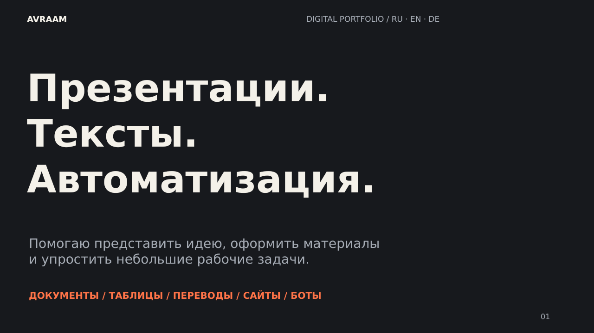
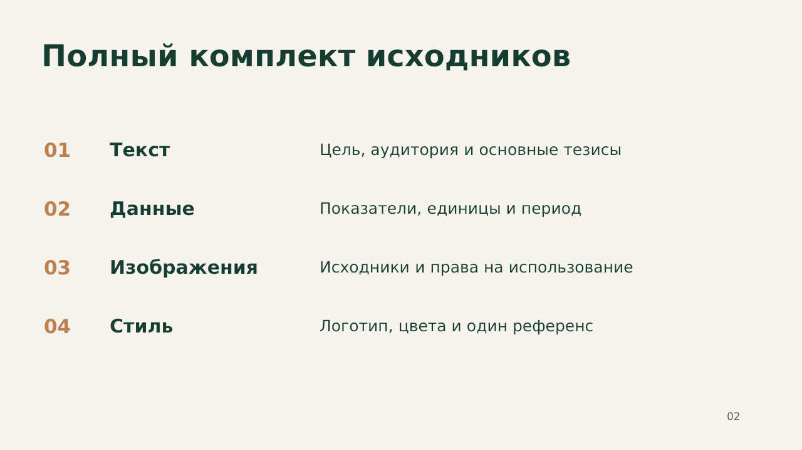
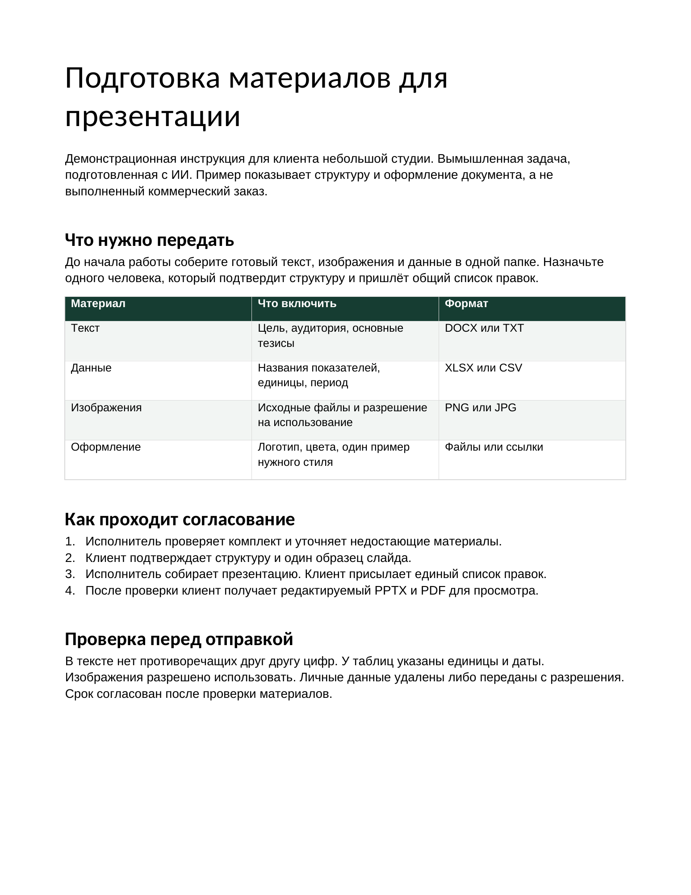
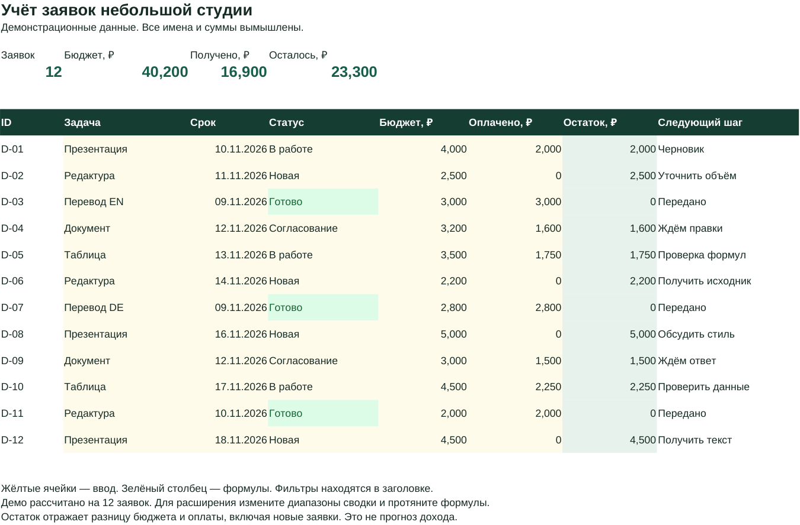

# Avraam · Presentations & documents

Презентации, тексты, таблицы и небольшие цифровые инструменты. Помогаю представить идею и упростить рабочую задачу. Здесь собраны **демонстрационные проекты, подготовленные с ИИ**. Это не клиентские заказы и не подтверждение коммерческого опыта.

[Открыть портфолио PDF](files/Portfolio_Avraam_Final.pdf) · [Редактируемое портфолио PPTX](files/Portfolio_Avraam_Final.pptx)

## 01 · Презентация для клиента

**Задача:** превратить неструктурированное описание в памятку о подготовке материалов.

**Результат:** пять редактируемых слайдов, единые цвета и типографика, понятные этапы согласования. Макет проверен, подготовлена версия для просмотра.

[PowerPoint](files/Presentation_Brief_Demo_Final.pptx) · [PDF](files/Presentation_Brief_Demo_Final.pdf)

## 02 · Документ и редактура

**Задача:** собрать инструкцию, сохранив требования исходного текста.

**Результат:** две страницы, таблица материалов, шаги согласования и пример «до/после» с объяснением изменений. Готовые факты не выдумывались; источник задания создан специально для демонстрации.

[Word](files/Client_Brief_Guide.docx) · [PDF](files/Client_Brief_Guide.pdf) · [Текст до/после](files/Editing_Before_After.txt)

## 03 · Учёт заявок в Excel

**Задача:** видеть статусы, бюджет и оплату небольшого списка заявок.

**Результат:** фильтры, выпадающие статусы, формулы остатка и четыре сводных показателя. В примере 12 вымышленных заявок: 40 200 ₽ бюджета, 16 900 ₽ оплаты, 23 300 ₽ разницы. Пересчёт при изменении ввода проверен.

[Excel](files/Requests_Tracker.xlsx) · [PDF-превью](files/Requests_Tracker_Preview.pdf)

Демонстрация рассчитана на 12 строк. При расширении нужно изменить диапазоны сводных формул и продолжить формулы остатка. Разница бюджета и оплаты не является прогнозом дохода. Нет макросов и внешних подключений.

## 04 · Деловое сообщение RU / EN / DE

Один короткий текст о согласовании презентации: смысл, порядок действий и вежливый тон сохранены в трёх версиях. Это общая деловая переписка, не заверенный или специализированный перевод.

[Тексты и терминология](files/Client_Message_RU_EN_DE.md) · [PDF](files/Client_Message_RU_EN_DE.pdf)

## 05 · Небольшая автоматизация

[Catalog CSV Checker](https://github.com/phillipp-preobrayhensky/catalog-csv-checker) — отдельный учебный репозиторий с кодом и девятью тестами. Проверяет CSV перед импортом и объясняет отклонённые строки.

## 06 · ИИ, контент и открытая информация

[Демонстрационный контент-план, три текста и повторно используемый промпт](files/Content_AI_Demo.md).

Дополнительные направления: поиск и структурирование открытой информации, краткие обзоры и сравнения, шаблоны задач для ИИ.

## 07 · Сайты и Telegram-боты

Небольшие прототипы по согласованному заданию: каталог, форма заявки, сценарий бота, напоминания. Python с ИИ, Telegram, Git / GitHub, Supabase. Интеграции, хостинг и поддержка обсуждаются отдельно.

Reelsy — проект Telegram-помощника для SMM в разработке. CoinScan — проект каталога монет на стадии концепции и развития. Эти проекты не выдаются за завершённые клиентские заказы.

## Происхождение и границы

Новые тексты, оформление, таблица и код созданы ассистентом по заданию владельца портфолио. Выполнены автоматические и визуальные проверки в среде подготовки. Учебные примеры показывают подготовленный результат и подход к работе; коммерческие результаты и опыт поддержки сложных систем здесь не заявляются.

Здесь нет личных финансовых документов, школьных сведений, фотографий других людей и материалов реальных клиентов. Ранее созданные коллективные работы не приписываются владельцу этого профиля.

**EN:** AI-assisted demonstration portfolio. Editable files and previews are included. No client outcomes or completed paid engagements are claimed.
